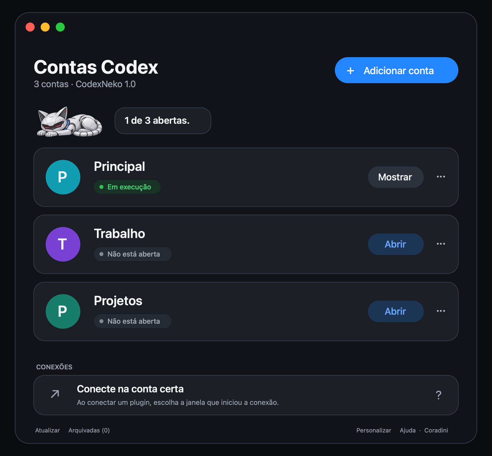

# CodexNeko para macOS

**Adicione e abra várias contas do Codex sem usar o Terminal.**

Aplicativo gratuito e de código aberto, com interface em português. Cada
conta abre uma instância do aplicativo oficial do Codex com seu próprio login.

[Baixar o app e o instalador](https://github.com/leandrocora/codexneko/releases)
· [English](docs/README.en.md)
· [Como contribuir](CONTRIBUTING.md)



> Prévia ilustrativa com contas fictícias. A versão inicial é uma **beta**.

## O que você pode fazer

- **Adicionar conta:** escolha um nome e uma cor; a nova janela abre para login.
- **Abrir ou mostrar:** mantenha várias contas abertas e volte à janela desejada.
- **Editar:** altere o apelido e a cor de cada conta.
- **Arquivar e restaurar:** organize a lista mantendo o login e os dados.
- **Reconhecer perfis existentes:** a instalação padrão do Multi Codex é lida
  automaticamente.
- **Conectar plugins:** o helper original permite escolher qual perfil recebe
  a conexão iniciada no navegador.
- **Personalizar o mascote:** gato robô branco de olhos vermelhos, com versões
  macho (padrão) e fêmea. A escolha é salva e muda também o ícone no Dock.
- **Usar o tema escuro:** painel, formulários e janelas de ajuda em modo escuro.

O gerenciador não solicita senhas. Você faz login no aplicativo oficial do
Codex. As contas mantêm seus próprios limites e assinaturas.

## Requisitos

| Item | Compatibilidade inicial |
| --- | --- |
| Sistema | macOS 13 ou posterior |
| Processador | Apple Silicon, como M1, M2, M3, M4 e posteriores |
| Codex | Aplicativo oficial instalado |
| Idioma da interface | Português do Brasil |
| Intel, Windows e Linux | Sem pacote gráfico nesta versão |

Não é necessário instalar Node, Go ou Swift para usar o app baixado.

## Instalação

1. Abra a página de [Releases](https://github.com/leandrocora/codexneko/releases).
2. Baixe **CodexNeko-macOS-Installer.pkg** e abra o instalador. O destino é
   **Aplicativos → CodexNeko**.
3. Ou baixe **CodexNeko-macOS-AppleSilicon.zip**, extraia e arraste
   **CodexNeko.app** para sua pasta de Aplicativos.
4. Abra o CodexNeko.

Os pacotes atuais usam assinatura local e não são notarizados pela Apple.
Se o macOS bloquear a primeira abertura, confira a origem do download e use
**Ajustes do Sistema → Privacidade e Segurança → Abrir Mesmo Assim**, quando
essa opção estiver disponível. Não desative as proteções do sistema.

`SHA256SUMS.txt` acompanha a release para conferir a integridade dos pacotes.

### Atualizar uma instalação existente

Abra o novo **CodexNeko-macOS-Installer.pkg**. O instalador detecta o app em
**Aplicativos → CodexNeko**, compara a versão e o número do build e atualiza
essa mesma instalação. Ele pede para fechar o gerenciador quando necessário.
Contas, logins, conversas e a escolha do mascote ficam preservados.
Uma versão mais antiga não substitui uma versão mais nova; reinstalar a mesma
versão é permitido. A verificação automática se aplica ao instalador `.pkg`.

Se você instalou a versão anterior como **MultiCodex**, use o `.pkg` para
atualizar para **CodexNeko**. O instalador reconhece os dois nomes e mantém
as contas e a personalização. Depois de validar a nova cópia instalada,
guarda o aplicativo antigo em `/Library/Application Support/CodexNeko/Previous Versions/`,
evitando duas cópias na pasta Aplicativos. Se a validação falhar, o app
anterior é preservado. O ZIP é destinado a instalações manuais.

### Escolher o mascote

Use **Personalizar** no rodapé ou **CodexNeko → Personalizar…** (`⌘,`).
O macho usa luz azul; a fêmea usa luz rosa e um pequeno laço metálico.
Os dois aparecem deitados dormindo ao lado do contador de janelas abertas.
No Dock, o rosto do gato robô aparece com os olhos vermelhos acesos.

## Adicionar outra conta

1. Clique em **Adicionar conta**.
2. Informe um apelido, como **Pessoal** ou **Trabalho**, e escolha a cor.
3. Clique em **Criar e abrir**.
4. Na nova janela do Codex, entre com a outra conta.

Depois, use **Abrir** ou **Mostrar** na lista. Fechar o gerenciador mantém
as janelas do Codex abertas.

Os apelidos são locais. Renomear um perfil não muda seu endereço de e-mail
ou sua conta OpenAI.

## Arquivar e restaurar

No menu `…` da conta, escolha **Arquivar conta**. O login e os dados são
preservados. Use **Arquivadas → Restaurar** para trazer a conta de volta.

A instalação original permanece disponível como conta principal.
Perfis com compartilhamento de conversas ou memórias ativado precisam
desativá-lo antes de serem arquivados.

## Conexões e plugins

Inicie a conexão dentro da janela do Codex que deve receber o plugin. Ao
voltar do navegador, selecione essa mesma conta no seletor do Multi Codex.
Confira também a conta aberta no navegador durante a autorização do serviço.

Em **Como funciona → Manutenção**, você pode verificar e reparar a instalação.

## Seus dados

Os perfis usam a instalação padrão em:

```text
~/Library/Application Support/Multi Codex/
```

O primeiro perfil continua usando a instalação original do Codex. Os novos
perfis recebem diretórios próprios de dados e autenticação. O gerenciador não
copia suas credenciais entre contas e não implementa login por conta própria.

Compartilhamentos configurados anteriormente no projeto original são
respeitados. Conversas de contas diferentes não são mescladas pelo gerenciador.

O código-fonte e os pacotes distribuídos não incluem perfis, credenciais,
conversas, bancos de dados ou configurações do autor.

## Compilar a partir do código

Você precisa de um Mac Apple Silicon com as ferramentas Swift da Apple
instaladas. Na primeira compilação, o script baixa a versão fixa `v0.2.1`
do backend original e verifica os hashes SHA-256 do arquivo e do executável.

```sh
git clone https://github.com/leandrocora/codexneko.git
cd codexneko
bash scripts/download-manager-backend.sh
bash scripts/build-macos-manager.sh
```

Resultado: `dist/CodexNeko.app`.

Para gerar ZIP, instalador e checksums:

```sh
bash scripts/package-macos-manager.sh
```

O download inicial do backend requer internet. Com o backend verificado em
`release/`, a compilação Swift usa apenas o SDK local.

## Testes e estágio da versão

A compilação executa **19 testes automatizados** do gerenciador. Eles cobrem
isolamento dos perfis, criação parcial, falhas, nomes inválidos, arquivamento,
restauração, concorrência e o contrato de leitura com o executável original.
Os testes usam dados sintéticos e não alteram suas contas reais.
O empacotamento executa também **22 testes do instalador**, incluindo atualização,
reinstalação, bloqueio de downgrade, migração do nome anterior e preservação
de contas e preferências.

```sh
dist/CodexNeko.app/Contents/MacOS/CodexNeko --self-test
```

O fluxo de login, a abertura gráfica e as conexões de plugins ainda precisam
de validação manual para a promoção desta beta a uma versão estável.
Consulte o [guia de validação](docs/TESTING.md).

## Publicação e estrutura

O GitHub Actions está configurado para compilar e testar o app em Apple
Silicon. Tags `v*` geram uma release com ZIP, instalador e checksums. Tags com
sufixo, como `v1.0.0-beta.1`, são marcadas como pré-lançamento.

| Caminho | Conteúdo |
| --- | --- |
| `native/manager/` | Interface SwiftUI/AppKit e integração com os perfis |
| `scripts/*manager*` | Download verificado, compilação e empacotamento |
| `scripts/export-public-source.py` | Exportação de código por lista explícita |
| `scripts/publish-github.sh` | Criação de um repositório público novo e envio da tag |
| `cmd/multi-codex-app/`, `native/macos/` | Código preservado do projeto original |
| `docs/upstream/` | Documentação e workflows originais, para referência |

Detalhes de implementação estão em [Arquitetura](docs/ARCHITECTURE.md).

## Créditos e licença

Interface para macOS por **Leandro Nery Coradini / Coradini**.

O gerenciamento dos perfis usa
[am-will/multi-codex-app](https://github.com/am-will/multi-codex-app), por
**William Ryan**, sob a licença MIT. O projeto original credita a metodologia
de perfis separados de **Edi Hasaj**. Veja a [origem dos componentes](UPSTREAM.md).

O código é disponibilizado gratuitamente sob a [licença MIT](LICENSE).
As marcas e os ícones OpenAI/Codex continuam pertencendo aos respectivos
titulares; consulte as [notas dos ícones originais](cmd/multi-codex-app/assets/icons/README.md).

Projeto independente, sem vínculo ou endosso da OpenAI.
