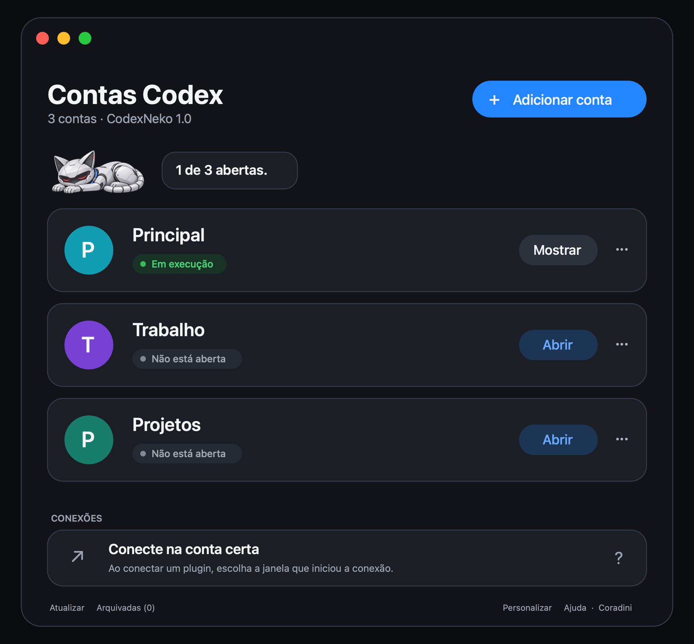

# CodexNeko for macOS

Free, open-source account manager for the official Codex desktop app.
Add an account, choose its name and color, and sign in through its new Codex
window. The interface currently uses Brazilian Portuguese.

[Downloads](https://github.com/leandrocora/codexneko/releases)
· [Documentação em português](../README.md)



## Requirements and installation

- macOS 13 or later on Apple Silicon.
- The official Codex desktop app must already be installed.
- Download the `.pkg` installer, or extract the app ZIP and drag
  `CodexNeko.app` into Applications.
- Open the manager and choose **Adicionar conta → Criar e abrir**.

Existing profiles from the standard Multi Codex installation are recognized.
Use **Abrir/Mostrar** to open or focus a profile. **Arquivadas** contains
archived accounts that can be restored without discarding their saved data.

The interface uses a dark theme. **Personalizar** lets you choose the white
robot-cat mascot: male with blue lights (default), or female with pink lights
and a small metal bow. Both have red LED eyes. A sleeping cat appears beside
the running-window counter; the Dock icon follows your saved selection.

To update, open the new `.pkg` installer. It detects the existing app in
`/Applications/CodexNeko.app`, compares version and build, and replaces that
installation while keeping profiles and preferences. Older versions are
blocked; reinstalling the same version is allowed.

The `.pkg` also recognizes earlier installations named **MultiCodex**.
After verifying the installed CodexNeko replacement, it archives the former
app under `/Library/Application Support/CodexNeko/Previous Versions/`.
Accounts and mascot preferences stay in their existing locations. A failed
validation preserves the former app. The ZIP does not perform this migration.

This beta is locally signed, without Apple notarization. See macOS Privacy &
Security if the first launch is blocked. Do not disable Gatekeeper.

## Build

```sh
bash scripts/download-manager-backend.sh
bash scripts/build-macos-manager.sh
bash scripts/package-macos-manager.sh
```

The initial backend download is pinned to upstream v0.2.1 and checked with
SHA-256. The Swift build uses the local Apple SDK. No Node or Go installation
is needed for the graphical manager.

The build runs 19 automated tests with synthetic accounts. Packaging also runs
22 installer and migration tests for upgrades, reinstalls, downgrade prevention,
verified replacement, backups, and preservation of profile data and preferences. GUI startup, real
sign-in, and plugin callbacks still require manual validation before a stable
release. See [Testing](TESTING.md).

## Credits and license

macOS interface by Leandro Nery Coradini / Coradini. Profile management uses
[am-will/multi-codex-app](https://github.com/am-will/multi-codex-app) by William
Ryan under the MIT license. Original credits and notices are preserved.
See [LICENSE](../LICENSE) and [UPSTREAM.md](../UPSTREAM.md).

Independent project, not affiliated with or endorsed by OpenAI.
